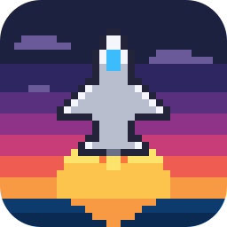
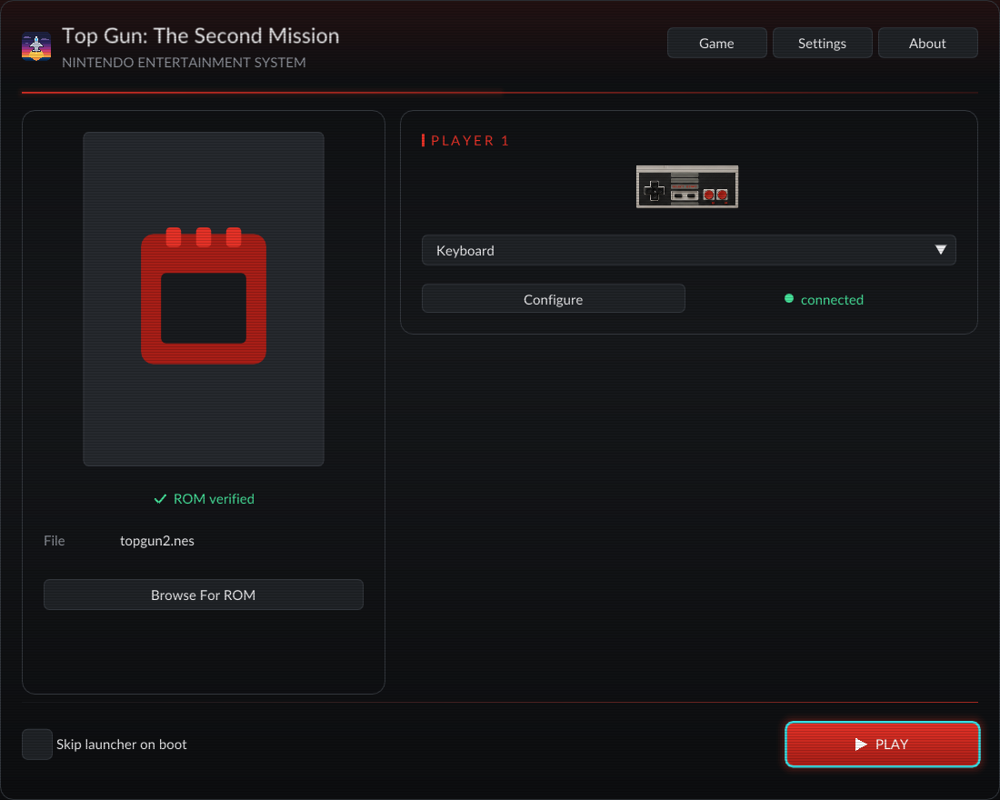
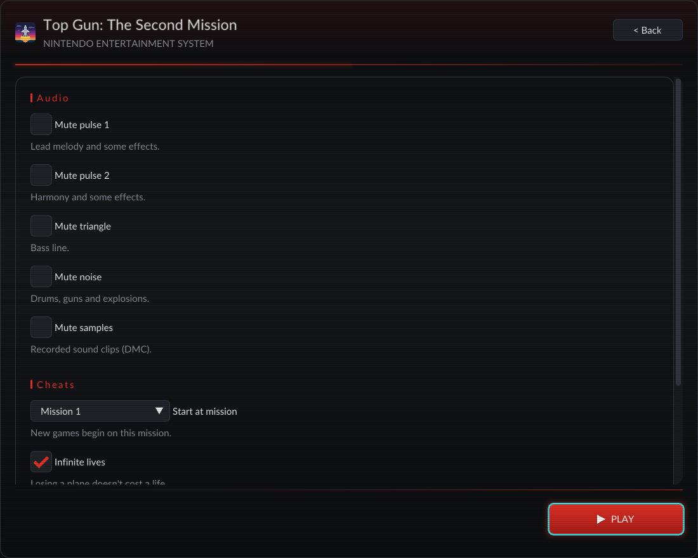
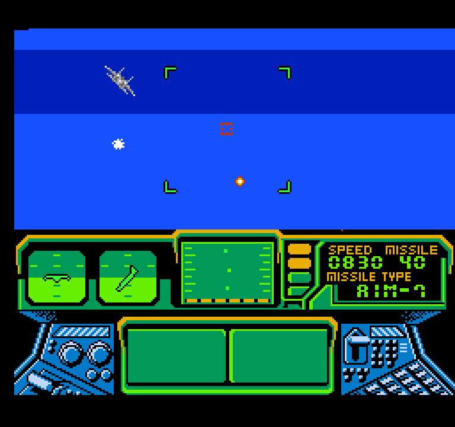
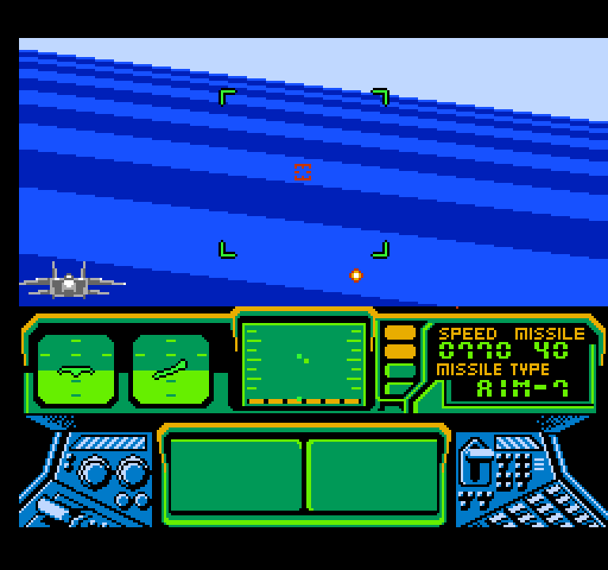
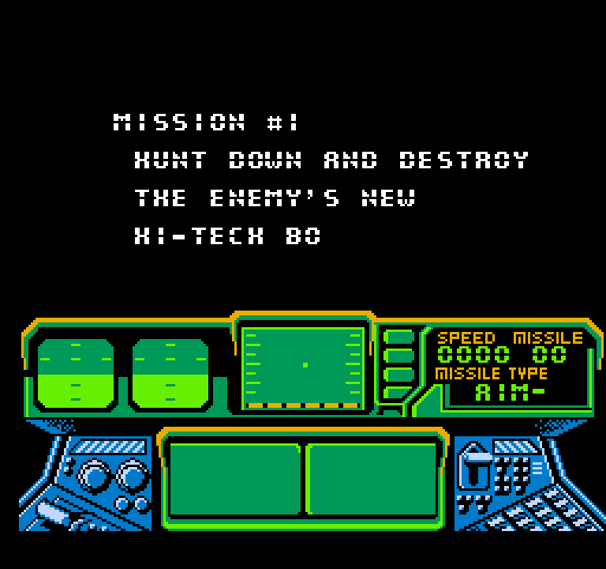

<p align="center">
  
</p>

<h1 align="center">Top Gun: The Second Mission, native for Mac, Windows and Linux</h1>

<p align="center">
  The 1990 NES game, rebuilt as a real program for your computer.<br>
  Crisp pixels at any size, a proper launcher, controller support, and cheats.<br>
  <b>Free. Bring your own copy of the game.</b>
</p>

## Download

| Your computer | Download | |
|---|---|---|
| **Mac** (Apple chip or Intel, macOS 11+) | [**TopGun2-Mac.zip**](https://github.com/TanookiStudios/TopGun2Recomp/releases/latest/download/TopGun2-Mac.zip) | Signed and notarized by Apple |
| **Windows** (64-bit) | [**TopGun2-Windows.zip**](https://github.com/TanookiStudios/TopGun2Recomp/releases/latest/download/TopGun2-Windows.zip) | |
| **Linux** (64-bit, most desktops from 2020 on) | [**TopGun2-Linux.tar.gz**](https://github.com/TanookiStudios/TopGun2Recomp/releases/latest/download/TopGun2-Linux.tar.gz) | |

Every version and its notes are on the [Releases page](https://github.com/TanookiStudios/TopGun2Recomp/releases).

## How to play

1. Download the version for your computer and unzip it.
   - **Mac:** drag **Top Gun 2** into Applications (or anywhere) and double-click it.
   - **Windows:** open the folder and double-click **TopGun2.exe**.
   - **Linux:** open the folder and double-click **TopGun2** (or run `./TopGun2`).
2. The launcher asks for your game file. Pick your own **Top Gun: The Second Mission (USA)** `.nes` file.
   The launcher checks it and shows **ROM verified** when it's the right one.
3. Set any options you like (the **Game** button has the cheats and sound switches), then press **Play**.

No game files come with this download. You need your own copy of the cartridge's data. The one that works is:

| | |
|---|---|
| Game | Top Gun: The Second Mission (USA) |
| SHA-256 | `99a4eb6cc3fb2f26de3d1b8b49d2936e76b46e4a8ef5da93f61f657a5188000e` |

### Controls

| NES | Keyboard |
|---|---|
| D-pad | Arrow keys |
| A | Z |
| B | X |
| Start | Enter |
| Select | \\ |
| **Menu** | **Esc** |

Xbox, PlayStation and Switch Pro controllers work without setup. Everything can be remapped in **Settings**.

## What's in it

- **Native code.** The game's own program was translated into native code, so it runs as a real Mac, Windows or Linux app.
- **Crisp at any size.** Whole-number scaling keeps every pixel sharp, from a small window to a 4K screen.
- **Launcher.** Set everything before you play: display, sound, controls, cheats.
- **In-game menu (Esc).** Change settings, save and load states, reset the game, or close it.
- **Sound.** Volume, and a mute switch for each of the NES's five sound channels.
- **Cheats.** Infinite lives, infinite missiles, can't be hit, start at any mission, and skip to the next mission.

## Screenshots

<p>
  
  
</p>
<p>
  
  
  
</p>

## Building it yourself

You need your own ROM for this too: the build reads it to translate the game, and nothing from it is stored in this repository.

```sh
./setup.sh                                  # fetches the engine at the tested versions and applies patches/
cp "/path/to/Top Gun - The Second Mission (USA).nes" rom/topgun2.nes
cmake -S . -B build -G Ninja -DCMAKE_BUILD_TYPE=Release -DNESRECOMP_RECOMP_UI="$PWD/vendor/recomp-ui"
cmake --build build
```

Release builds: `tools/make_app.sh --notarize` (Mac), `tools/make_windows_zip.sh` (Windows, cross-built on a Mac),
`tools/make_linux.sh` (Linux, built in an Ubuntu 20.04 container). Screenshots: `tools/capture-screenshots.sh`.

## About Maddie

Hi, I'm Maddie. I make apps and games on my own at [Tanooki Studios](https://tanookistudios.com).

I love old NES games, and I wanted to play them on a modern computer the way they deserve: crisp pixels at any size,
a real settings screen, controllers that just work, and a few cheats for when a mission is being mean.
So I rebuilt Top Gun: The Second Mission as a native program for Mac, Windows and Linux.

It's free, and it'll stay free. Making these is how I pay my bills, though.
If this made you smile, a tip helps me keep going. No pressure at all.


**[Leave a Tip](https://tanookistudios.com/SupportMe)**

## Credits and legal

- Built on [NESRecomp](https://github.com/mstan/nesrecomp) by Matthew Stanley (PolyForm Noncommercial 1.0.0)
  and [recomp-ui](https://github.com/mstan/recomp-ui) (MIT), with [SDL](https://libsdl.org) (zlib) and
  [Dear ImGui](https://github.com/ocornut/imgui) (MIT). Full texts: [THIRD_PARTY_NOTICES.md](THIRD_PARTY_NOTICES.md).
- This project's own code is under the [PolyForm Noncommercial License 1.0.0](LICENSE). It may never be sold.
- Top Gun is a trademark of Paramount Pictures. Top Gun: The Second Mission was published by Konami.
  NES is a trademark of Nintendo. This project is not made by, endorsed by, or affiliated with any of them.
  It contains no game data: you supply your own.
